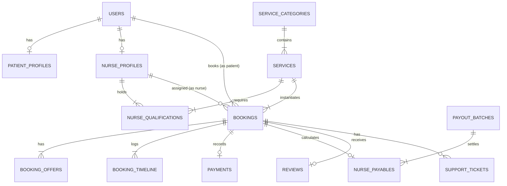
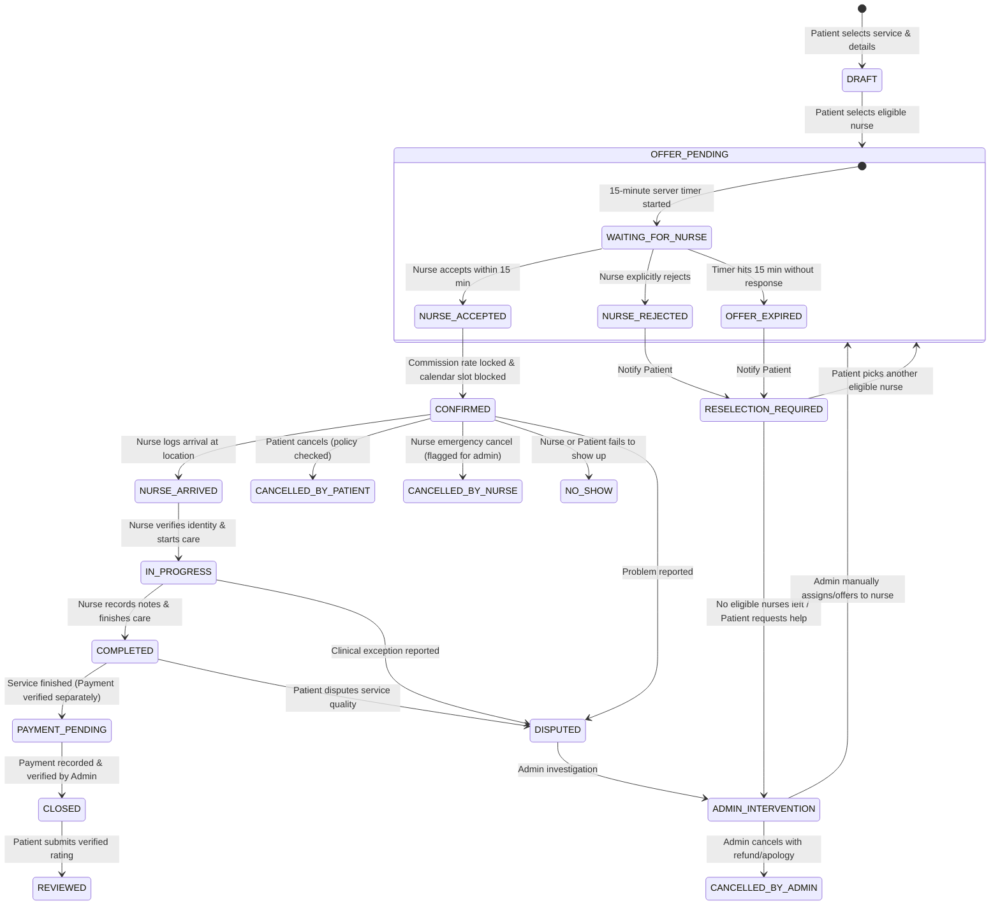
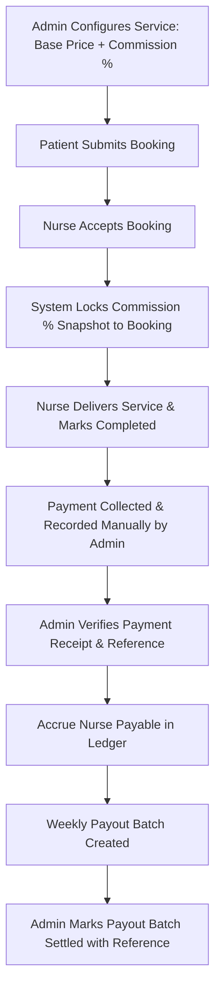
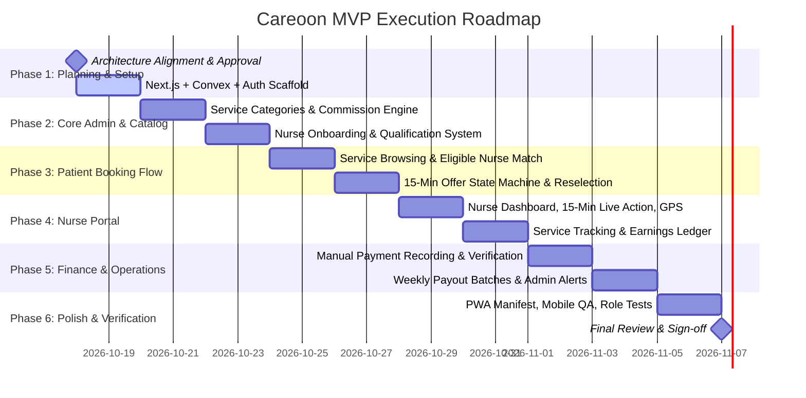

# CAREOON — HOME NURSING MARKETPLACE MVP
## System Architecture, Technical Blueprint & Execution Roadmap

---

## 1. Executive Summary & Repository Audit

### 1.1 Repository Status
* **Location**: `d:\WINIKS\012-Careoon`
* **Current State**: Fresh, clean-slate directory. No git initialization, no configuration files, and zero existing dependencies.
* **Local Runtime Environment**: Node.js `v24.11.0`, npm `11.11.1`, Windows OS.
* **Scope Boundary**: Dedicated home nursing services marketplace. Doctor search, clinic booking, and generic medical teleconsultation are explicitly excluded from this system.

---

## 2. Proposed Architecture & Technology Stack

```
+-----------------------------------------------------------------------------------+
|                           CLIENT TIER (Mobile-First Web / PWA)                    |
|  - Patient Portal (PWA)       - Nurse Portal (PWA)       - Admin Portal (Desktop/Web)  |
|  - Responsive Mobile Shell, Touch Optimization, Offline-Aware State Machine       |
+-----------------------------------------------------------------------------------+
                                          |
                      HTTPS / WSS (WebSocket Queries & Subscriptions)
                                          |
+-----------------------------------------v-----------------------------------------+
|                                HOSTING & ROUTING                                  |
|  - Framework: Next.js 15 (App Router) deployed via Cloudflare Pages / OpenNext     |
|  - Static Assets, Service Worker, Manifest.json, Responsive UI Components         |
+-----------------------------------------------------------------------------------+
                                          |
                                          v
+-----------------------------------------------------------------------------------+
|                        BACKEND & PERSISTENCE TIER (Convex)                        |
|  - Realtime Document Database (Convex Cloud)                                      |
|  - ACID Server Functions (Queries, Mutations, Actions, Schedulers)                |
|  - Server-Enforced State Machine (15-min countdown, status locking)               |
|  - Role-Based Access Control (RBAC) & Row-Level Authorization                      |
|  - Scheduled Jobs / Crons: 15-minute offer timeouts, overdue booking checks       |
+-----------------------------------------------------------------------------------+
        |                                 |                                 |
        v                                 v                                 v
+------------------+             +------------------+             +------------------+
|   AUTHENTICATION |             |  FILE & MEDIA    |             | COMMUNICATIONS & |
|  - Better Auth   |             |  - Cloudflare R2 |             |    TELEMETRY     |
|    or Convex-Auth|             |    (Encrypted    |             |  - Resend Email  |
|  - Session / JWT |             |    Licenses,     |             |  - PostHog       |
|  - Role Tokens   |             |    IDs, Certs)   |             |    (Privacy Opt) |
+------------------+             +------------------+             +------------------+
```

### 2.1 Technology Selection Rationale
1. **Frontend**: Next.js 15 (App Router) + Tailwind CSS + Lucide Icons. Provides server rendering for SEO/marketing landing pages, dynamic mobile web application views for portals, and native PWA support.
2. **Backend & Database**: **Convex**.
   * Realtime reactive subscriptions give instantaneous state updates when a nurse accepts an offer, cancels, or arrives, without manual polling.
   * Atomic ACID mutations prevent race conditions (e.g., preventing two nurses from accepting the same booking, or accepting an expired offer).
   * Built-in Scheduled Functions (`ctx.scheduler.runAfter`) natively handle the 15-minute offer response deadline server-side.
3. **Authentication**: **Convex Auth** or **Better Auth with Convex adapter**.
   * Secure session tokens, password hashing via Argon2id/Bcrypt, role claims embedded in sessions (`patient`, `nurse`, `admin`).
   * Zero shared passwords; nurses invited via cryptographic one-time activation links.
4. **Private Storage**: Cloudflare R2 (S3-compatible API with pre-signed URLs) for nurse licenses, background checks, and identity proof.
5. **Transactional Comms**: Resend (with local fallback mock logger during initial development).

---

## 3. Portal & Route Inventory

```
/ (Root Landing & Portal Selector)
├── /patient
│   ├── /login & /register
│   ├── /services (Catalog by Category)
│   ├── /services/[serviceId] (Details, Price, Duration, Eligibility Rules)
│   ├── /book/[serviceId] (Address, Date/Time, Clinical Notes, Nurse Selector)
│   ├── /bookings (Active & Past Bookings)
│   ├── /bookings/[bookingId] (Live Tracker, 15-min Offer Countdown, Reselection, Arrived/In-Progress/Completed)
│   ├── /bookings/[bookingId]/review (Post-completion verified review)
│   └── /profile & /support
├── /nurse
│   ├── /login & /activate/[token] (Invitation activation)
│   ├── /dashboard (Current Offers with live 15-min deadline, Today's Schedule)
│   ├── /offers/[offerId] (Accept / Reject with rationale)
│   ├── /jobs/[bookingId] (Status transitions: "On My Way" -> "Arrived" -> "In Progress" -> "Complete")
│   ├── /earnings (Payable balance, net earnings per completed job, payout history)
│   ├── /availability (Service Area selector & Active/Offline toggle)
│   └── /profile (Approved qualifications, badges, credentials)
└── /admin
    ├── /login (Admin authentication with secure MFA/role verification)
    ├── /dashboard (System overview, pending response alerts, timeout alerts, unassigned jobs)
    ├── /services (Create/Edit Services, set Commission %, Areas, Eligibility)
    ├── /nurses (Nurse directory, invite nurse, verify qualifications, approve/suspend)
    ├── /patients (Patient directory, booking history)
    ├── /bookings (Live operations board, manual reassignment, operational intervention)
    ├── /finance
    │   ├── /payments (Record manual payments, verify receipts, track pending)
    │   ├── /ledger (Commission snapshot view, nurse payable balance)
    │   └── /payouts (Weekly payout batch creator, settlement marker)
    ├── /disputes & /support (Customer complaints, no-show disputes, resolution)
    └── /audit-logs (Immutable log of all administrative actions)
```

---

## 4. Role-Permission Matrix

| Resource / Action | Guest | Patient | Nurse | Admin | Backend Rule / Constraint |
| :--- | :---: | :---: | :---: | :---: | :--- |
| **Browse Services & Categories** | Yes | Yes | Yes | Yes | Only `isActive == true` visible to non-admins |
| **View Service Commission %** | No | No | No | **Yes** | Commission rate strictly hidden from public & nurses |
| **Configure Commission %** | No | No | No | **Yes** | Sets rate per service; locks snapshot on booking |
| **Create Booking Request** | No | Yes | No | Yes | Patient can only book for themselves |
| **View Booking Details** | No | Own | Assigned | **All** | IDOR protection: verified via session identity |
| **Receive Booking Offer** | No | No | Target | All | Offer created by backend with 15-min expiration |
| **Accept / Reject Offer** | No | No | Target | No | Server rejects if `expiresAt < now()` or already decided |
| **Reselect Nurse (on timeout/reject)** | No | Yes | No | Yes | Allowed only when status is `reselection_required` |
| **Update Service Progress** | No | No | Assigned | Yes | Sequential state machine enforcement |
| **Record Payment Received** | No | No | No | **Yes** | Manual entry: method, reference, amount, verified |
| **View Nurse Earnings & Ledger** | No | No | Own | **All** | Nurse sees only net payable; admin sees full ledger |
| **Create Payout Batch** | No | No | No | **Yes** | Aggregates eligible unbatched nurse payables |
| **Invite / Approve Nurse** | No | No | No | **Yes** | Generates secure one-time token |
| **Submit Review** | No | Yes | No | No | Allowed only once per completed, verified booking |
| **Access Audit Logs** | No | No | No | **Yes** | Read-only immutable append-log |

---

## 5. Database Schema & Relationships (Convex)



### Table Definitions

1. `users`
   * `email: string` (indexed)
   * `role: "patient" | "nurse" | "admin"`
   * `fullName: string`
   * `phoneNumber: string`
   * `status: "active" | "suspended" | "pending_activation"`
   * `createdAt: number`

2. `patientProfiles`
   * `userId: Id<"users">`
   * `defaultAddress: { street: string, city: string, postalCode: string, coordinates?: { lat: number, lng: number } }`
   * `emergencyContact: { name: string, phone: string, relationship: string }`
   * `medicalAlertNotes?: string`

3. `nurseProfiles`
   * `userId: Id<"users">`
   * `licenseNumber: string`
   * `qualificationStatus: "unverified" | "verified" | "rejected"`
   * `serviceAreas: string[]` (postal codes or district IDs)
   * `isAvailable: boolean`
   * `completedBookingsCount: number`
   * `cancellationCount: number`
   * `ratingAverage: number`
   * `ratingCount: number`

4. `serviceCategories`
   * `name: string`
   * `slug: string`
   * `description: string`
   * `icon: string`
   * `isActive: boolean`
   * `displayOrder: number`

5. `services`
   * `categoryId: Id<"serviceCategories">`
   * `name: string`
   * `slug: string`
   * `description: string`
   * `basePrice: number` (in currency cents/integers)
   * `durationMinutes: number`
   * `commissionPercentage: number` (e.g. `20.00` for 20%)
   * `serviceAreas: string[]`
   * `eligibilityConditions: string[]`
   * `isActive: boolean`

6. `nurseServiceQualifications`
   * `nurseId: Id<"nurseProfiles">`
   * `serviceId: Id<"services">`
   * `isApproved: boolean`
   * `approvedByAdminId?: Id<"users">`
   * `approvedAt?: number`

7. `bookings`
   * `patientId: Id<"users">`
   * `serviceId: Id<"services">`
   * `serviceAddress: { street: string, city: string, postalCode: string, instructions?: string }`
   * `scheduledDate: string` (YYYY-MM-DD)
   * `scheduledTimeSlot: string` (e.g., "10:00-11:00")
   * `status: BookingStatus`
   * `currentNurseId?: Id<"nurseProfiles">`
   * `servicePriceSnapshot: number` (locked at booking creation)
   * `lockedCommissionPercentage: number` (locked from service at confirmation)
   * `calculatedCommissionAmount?: number`
   * `calculatedNursePayable?: number`
   * `activeOfferExpiresAt?: number` (timestamp in ms)
   * `cancellationReason?: string`
   * `cancelledBy?: { userId: Id<"users">, role: "patient" | "nurse" | "admin" }`
   * `specialInstructions?: string`
   * `createdAt: number`
   * `confirmedAt?: number`
   * `arrivedAt?: number`
   * `startedAt?: number`
   * `completedAt?: number`

8. `bookingOffers`
   * `bookingId: Id<"bookings">`
   * `nurseId: Id<"nurseProfiles">`
   * `status: "pending" | "accepted" | "rejected" | "expired" | "superseded"`
   * `offeredAt: number`
   * `expiresAt: number` (strictly `offeredAt + 15 * 60 * 1000`)
   * `respondedAt?: number`
   * `rejectionReason?: string`

9. `bookingTimelineEvents`
   * `bookingId: Id<"bookings">`
   * `actorId: Id<"users">`
   * `actorRole: "patient" | "nurse" | "admin" | "system"`
   * `eventType: string` (e.g., `OFFER_SENT`, `OFFER_ACCEPTED`, `OFFER_TIMEOUT`, `NURSE_ARRIVED`, `PAYMENT_VERIFIED`)
   * `metadata?: any`
   * `timestamp: number`

10. `payments`
    * `bookingId: Id<"bookings">`
    * `amount: number`
    * `paymentMethod: "bank_transfer" | "cash_on_delivery" | "pos_terminal" | "card_manual_entry"`
    * `referenceNumber: string`
    * `status: "pending" | "received" | "partially_refunded" | "refunded" | "disputed"`
    * `receivedAt?: number`
    * `verifiedByAdminId?: Id<"users">`
    * `reconciliationStatus: "unreconciled" | "reconciled"`
    * `notes?: string`
    * `createdAt: number`

11. `nursePayables`
    * `bookingId: Id<"bookings">`
    * `nurseId: Id<"nurseProfiles">`
    * `grossServiceAmount: number`
    * `careoonCommissionAmount: number`
    * `adjustmentsAmount: number` (positive or negative with explanation)
    * `netPayableAmount: number`
    * `status: "accrued" | "approved" | "held" | "batched" | "paid"`
    * `holdReason?: string`
    * `payoutBatchId?: Id<"payoutBatches">`
    * `createdAt: number`

12. `payoutBatches`
    * `batchReference: string` (e.g. `PAY-2026-W42-01`)
    * `periodStartDate: string`
    * `periodEndDate: string`
    * `totalAmount: number`
    * `totalNursesCount: number`
    * `status: "draft" | "processing" | "completed" | "failed"`
    * `settledByAdminId?: Id<"users">`
    * `paymentReference?: string`
    * `completedAt?: number`
    * `createdAt: number`

13. `reviews`
    * `bookingId: Id<"bookings">`
    * `patientId: Id<"users">`
    * `nurseId: Id<"nurseProfiles">`
    * `rating: number` (1 to 5)
    * `reviewText: string`
    * `isPublic: boolean`
    * `createdAt: number`

14. `supportTickets`
    * `bookingId?: Id<"bookings">`
    * `reporterId: Id<"users">`
    * `reporterRole: "patient" | "nurse"`
    * `category: "cancellation" | "payment" | "clinical_concern" | "no_show" | "other"`
    * `subject: string`
    * `description: string`
    * `status: "open" | "in_investigation" | "resolved" | "dismissed"`
    * `resolutionNotes?: string`
    * `resolvedByAdminId?: Id<"users">`
    * `createdAt: number`

15. `auditLogs`
    * `actorId: Id<"users">`
    * `actorRole: string`
    * `action: string`
    * `entityType: string`
    * `entityId: string`
    * `details: { before?: any, after?: any, rationale?: string }`
    * `timestamp: number`

---

## 6. Booking State Machine



### Invariants & Concurrency Safeguards
* **Atomic Convex Mutations**: Prevents two nurses accepting the same offer or a nurse accepting after timeout.
* **Server-side 15-Minute Expiration Scheduler**: When `bookingOffers` is created, `ctx.scheduler.runAfter(15 * 60 * 1000, internal.bookings.expireOffer, { offerId })` is scheduled. Frontend displays a synchronous countdown, but the server is the single source of truth.
* **Reselection Without Retyping**: The `booking` document preserves the patient's address, special instructions, and scheduled slot. The patient only needs to select another qualified nurse.
* **Admin Alert on Exhaustion**: If all eligible nurses in that postal area have rejected or expired, the booking automatically transitions to `ADMIN_INTERVENTION` and triggers an urgent operational alert.

---

## 7. Nurse Eligibility & Recommendation Rules

When a patient books a service, nurses are filtered and ranked server-side using the following rules:

### Eligibility Filter (Strict Binary Conditions)
1. **Account Status**: `user.status === "active"` AND `nurseProfile.qualificationStatus === "verified"`.
2. **Service Area Match**: Patient service postal code/region exists in `nurseProfile.serviceAreas`.
3. **Service Qualification**: An entry exists in `nurseServiceQualifications` with `serviceId` where `isApproved === true`.
4. **Availability**: `nurseProfile.isAvailable === true`.
5. **No Conflicting Bookings**: Nurse has no other booking in `[scheduledTime - 60m, scheduledTime + duration + 60m]` (including travel buffer).
6. **No Prior Rejection on Current Booking**: Nurse has not already rejected or timed out on this specific booking instance.

### Display & Sorting Order
Eligible nurses are presented with transparent operational badges:
* **Verified Credentials**: Official government nursing registration / certification verified.
* **Completed Care Visits**: Count of successfully completed bookings.
* **Low Cancellation Rate**: Displayed as a reliability metric.
* **Average Rating & Review Count**: Verified patient reviews only.
* **Default Sort**: Highest completed visits & rating, ensuring patients have maximum confidence.

---

## 8. Financial Ledger: Commission, Payment, & Payout Model



### 8.1 Snapshot Immutability Formula
* At booking confirmation:
  $$\text{Locked Commission \%} = \text{service.commissionPercentage}$$
  $$\text{Careoon Commission} = \text{servicePriceSnapshot} \times \left(\frac{\text{Locked Commission \%}}{100}\right)$$
  $$\text{Nurse Net Payable} = \text{servicePriceSnapshot} - \text{Careoon Commission}$$
* If an Admin changes the service commission rate from 20% to 25% tomorrow, existing confirmed and completed bookings continue to execute under their locked snapshot.

### 8.2 Payment Separation Rule
* **Service Completion $\neq$ Payment Received**.
* Service completion merely transitions the booking to `COMPLETED / PAYMENT_PENDING`.
* Payment is recorded as an explicit financial entry with payment method (`cash_on_delivery`, `bank_transfer`, `pos_terminal`), payment reference, received date, and verified by an Admin user ID.

### 8.3 Nurse Payable & Weekly Payout Batching
* Each completed, payment-verified booking produces an immutable `nursePayables` record with status `accrued`.
* Admins can hold a payable if a patient files a legitimate complaint.
* On payout day (e.g., weekly), the Admin generates a `payoutBatch` aggregating all `accrued` payables.
* Once the external bank transfer is executed offline, the Admin records the payout batch as `completed` with the bank wire reference. No money is marked paid without an auditable reference.

---

## 9. Security, Privacy & Threat Assessment

| Threat Vector | Severity | Vulnerability Scenario | Careoon Architectural Countermeasure |
| :--- | :---: | :--- | :--- |
| **IDOR (Insecure Direct Object Reference)** | Critical | Patient guesses another booking ID and views home address / health notes. | **Convex Auth Session Verification**: Every query/mutation inspects `ctx.auth.getUserIdentity()`. Queries reject requests where `booking.patientId !== user._id` (unless role is `admin`). |
| **Nurse PII Leakage** | High | Unassigned nurse accesses patient home address before accepting job. | **Redaction Before Acceptance**: In `bookingOffers`, nurse sees only general neighborhood/district and service type. Full address and phone number are only revealed *after* `CONFIRMED`. |
| **Nurse Commission Leakage** | Medium | Nurse deduces platform margin or other nurses' pay rates. | **Separation of Concerns**: Nurse API queries only return `nurseNetPayable`. `lockedCommissionPercentage` and total platform revenue are stripped from all nurse endpoints. |
| **Privilege Escalation** | Critical | Patient or nurse crafts request to `/admin` endpoints. | **Server-side Role Guard**: `requireAdmin(ctx)` throws `UNAUTHORIZED` at the database mutation level; frontend route guards are merely UI conveniences. |
| **Race Conditions in Acceptance** | High | Two nurses accept same booking or nurse accepts after 15-min mark. | **Convex Atomic Mutation Isolation**: Single-threaded mutation commit guarantees an offer can only transition from `pending` to `accepted` once, and fails if `expiresAt < Date.now()`. |
| **Plaintext Password Compromise** | Critical | Nurse invited with shared default password (e.g. `Nurse2026!`). | **Cryptographic Activation Tokens**: Nurses are created in `pending_activation`. Admin triggers an invite link with a 72-hour crypto token. Nurse sets their own unique password upon onboarding. |

---

## 10. Operational Readiness: Standalone vs External Credentials

To ensure a working MVP immediately without blocking on external enterprise accounts, features are architected into two tiers:

| Component | Immediate MVP (Fully Functional Locally / Dev) | Production Scaled (Requires External Credentials) |
| :--- | :--- | :--- |
| **Database & Backend** | Convex Cloud Dev Deployment (Instant setup, free tier) | Convex Dedicated / Enterprise Instance |
| **Authentication** | Built-in Email/Password with Session Cookies | OAuth (Google/Apple) + Two-Factor Auth via SMS |
| **Payments** | Real manual recording, audit-verified bank transfer reference logging | Razorpay / Stripe automated webhook integration |
| **File Storage (Licenses)** | Convex File Storage (Built-in, fully working) | Cloudflare R2 bucket with custom IAM credentials |
| **Transactional Email** | In-app notification center + Console/Mock Logger | Resend API key + Verified DNS domain |
| **Product Analytics** | Internal Convex event logs | PostHog API token + Telemetry host |
| **Hosting** | Local dev server (`npm run dev`) / Cloudflare Pages staging | Cloudflare Custom Domain + SSL + WAF |

---

## 11. Implementation Milestones



### Measurable Acceptance Criteria per Milestone
* **M1 (Scaffold & Auth)**: Users can register/login as Patient, Nurse (via invite), or Admin with strict role cookies.
* **M2 (Admin Services & Commission)**: Admin can create services, set commission % (e.g. 18%), and assign nurse qualifications. Rate is visible only to Admin.
* **M3 (Booking & 15-Min Timer)**: Patient creates booking -> selects eligible nurse -> nurse sees live 15-min countdown -> on reject/timeout, patient can pick nurse #2 without retyping details.
* **M4 (Nurse Execution)**: Nurse accepts -> transitions through Arrived -> In Progress -> Completed with clinical timestamps.
* **M5 (Finance & Payouts)**: Admin records manual payment receipt -> verified -> locks commission snapshot -> creates weekly payout batch -> marks settled with reference.
* **M6 (QA & Security)**: Zero IDOR leaks; verified mobile touch UX; PWA install banner; zero TypeScript or lint errors.
